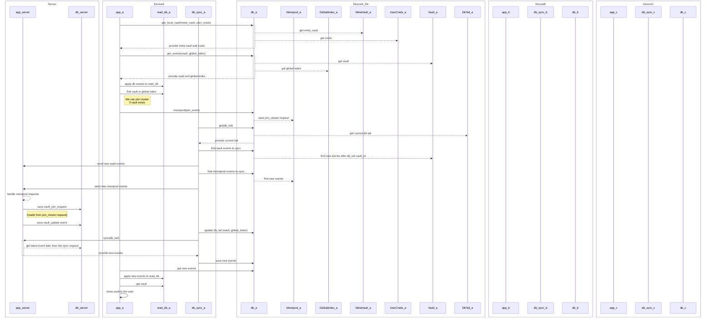

## meta-secret-core

#### "Join Cluster" operation, sequence diagram

## Fresh JOIN capacity preflight

Before producing a fresh NonMember or Declined JOIN, Core reads the current own status after its existing synchronization and sends `ReadSyncRequest::JoinAdmission(UserData)` through `/meta_request`. The server processes this read under its existing request ordering, before lazy initialization or maintenance. It validates the canonical Vault and exact candidate context without returning the Vault, member list, keys or history to the outsider.

The response is `DataSyncResponse::Empty` when capacity currently permits a request. Refusal is an ordinary `DataSyncResponse::Error` with only `Vault supports at most 3 devices` or `Join admission unavailable`; internal repository errors are not returned. Only Empty permits Core to proceed to the original local JOIN append. Unsupported servers, network errors and unexpected response variants fail closed without that new append. Deploy the compatible server before clients using this additive read; the mobile JSON/UniFFI API is unchanged.

This check does not reserve a slot, grant membership or replace another member's approval. The server validates actual admission again if topology changes after the read. Existing Pending, Member and new-Vault creation flows keep their original behavior. Previously queued or possibly sent requests are not canceled, removed or repaired by preflight. A capacity error is not permission to clear an unknown or accepted registration.

### Verification checkpoint

The real Mobile manager/service queue and HTTP ServerApp regression passes for a fresh fourth candidate: capacity rejection leaves its JOIN outbox unchanged and subsequent ordinary get_state remains usable. The two-member control produces exactly one Pending JOIN and still requires member approval. These Rust integration checks do not establish native UI Back/reset or original Test21 success; those remain separate validation gates.
