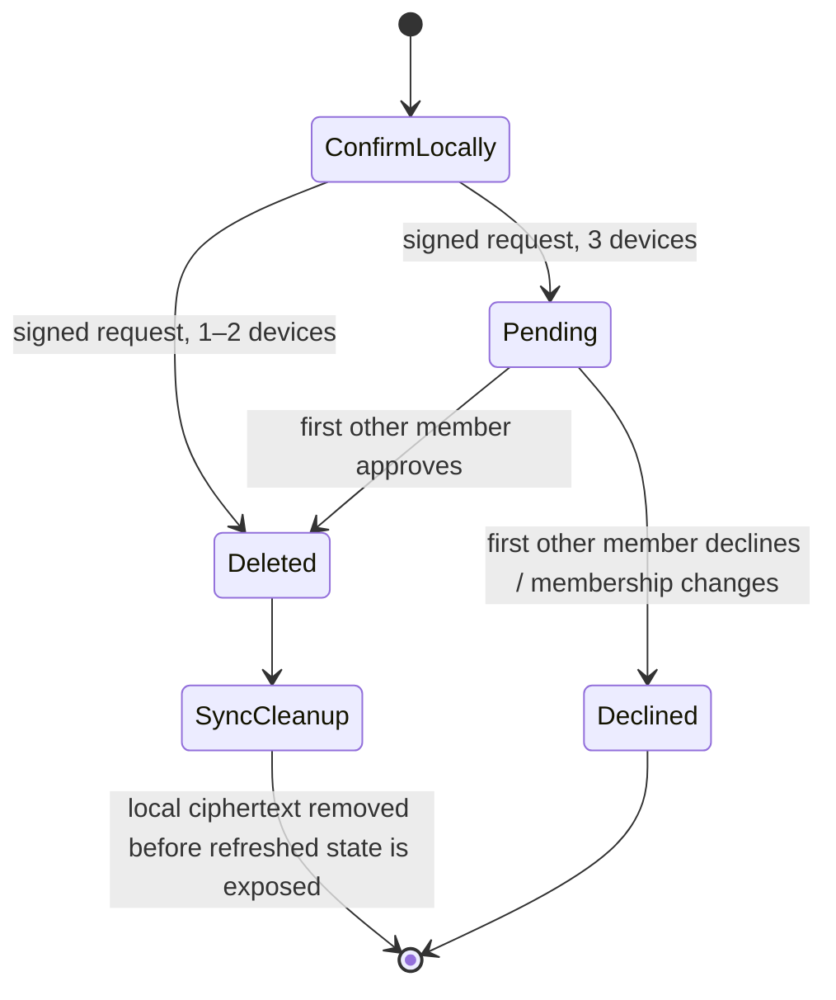

# Vault-wide Secret deletion

Core owns deletion authorization, lifecycle, cleanup and client instructions.
Deletion never reconstructs a Secret and never sends Key Shares to approve it.

## Confirmation

| Current Vault devices | Required confirmation |
|---|---|
| 1 | Local user confirmation on the initiator |
| 2 | Local user confirmation on the initiator; the second full copy is deleted by synchronization |
| 3 | Local confirmation followed by one other current member's approval |

The initiating member signs `DeleteSecretRequest` through `SignedAction`.
The request binds a Core-generated UUID, exact Pass ID, Vault, sender and sorted
membership set. At three devices another member signs `DeleteSecretDecision`.
The server resolves the signer from current membership and validates the device
log stream, signature, nonce and request before mutation. A first processed
approval deletes; a first decline preserves the Secret. A duplicate or opposite
late decision has no effect. Membership changes decline pending deletion
requests. An obsolete offline request is consumed without changing the Secret.



## Persistence and offline clients

Canonical `VaultData.deletedSecrets` retains tombstones for exact Pass IDs.
`VaultData.deletionResults` stores the winning outcome in the same atomic Vault
record as the tombstone. Canonical outcomes override missing/stale transient
VaultLog results, including after a restart or an interrupted metadata update.
Tombstones are written before idempotent cleanup, so an interrupted cleanup
cannot make a deleted Secret usable. Cleanup deletes every persisted
distribution/recovery ciphertext revision and removes affected ciphertext
transfers from device-removal history. Metadata records retain their sequence
numbers; sanitization replaces a record atomically in each database adapter.
This is logical deletion, not a guarantee of disk-sector erasure or destruction
of independently exported backups/plaintext.

An offline device applies the tombstone and cleanup during synchronization
before Core returns updated application state. Previously queued additions and
claims for a tombstoned Pass ID cannot revive the Secret. Recovery/reveal checks
reject deleted IDs. Recreating a deleted display name generates a fresh opaque
Pass ID; CLI/mobile name lookups resolve the current canonical ID.
After recreation, a second creation using that active display name is rejected
instead of introducing ambiguous duplicate IDs.

Clients show loading while they synchronize and apply deletions, including at
startup/reconnect. They clear revealed plaintext and obsolete recovery dialogs
when the selected Pass ID disappears. A Secret deletion does not remove a
Vault device or trigger resharing of other Secrets.

## Client contract

`UserMemberFullInfo.deletionStates` is a Core-computed array. Each entry includes
`passId`, `secretId`, `requestId`, `requiresApproval` and `clientStatus`.
An entry with no request ID is the confirmation policy for an existing Secret.
Request entries carry `Pending`, `NeedApprove`, `Done` or `Declined`.
Clients submit the exact request UUID; they do not calculate quorum or choose
approval behavior from device counts. Historical terminal entries are scoped to
their original Pass ID/UUID and must not be reused for a recreated Secret.

New UniFFI JSON methods:

- `delete_secret(secret_id: string) -> string`: canonical name or ID; returns the existing success/error JSON envelope.
- `decide_delete_secret(request_json: string) -> string`: JSON object with `requestId` (exact UUID) and `accepted` (boolean); same envelope. FFI arguments/returns remain strings.

Existing exports keep their signatures. Generate Kotlin/Swift bindings from the
same UDL as the native library. This protocol adds enum variants, so clients
must use the updated Core library to process deletion events. New fields use
defaults when decoding historical persisted data; old clients are not claimed
to understand the new protocol variants.

WASM exposes `delete_secret(MetaPasswordId)`, `decide_delete_secret(UUID, bool)`
and `WasmUserMemberFullInfo.deletion_states_json()`.

CLI commands:

```sh
meta-cli secret show-local --pass-name Example
meta-cli secret delete --pass-name Example
meta-cli secret delete --pass-name Example --yes
meta-cli secret deletion-requests
meta-cli secret approve-deletion --request-id <UUID> --yes
meta-cli secret decline-deletion --request-id <UUID>
```

Without `--yes`, deletion/approval asks for explicit local confirmation in an
interactive terminal. Noninteractive deletion/approval requires `--yes`.
JSON output reports the Core status; `Pending` means deletion has not happened.

The CLI lifecycle integration test starts an isolated in-memory server on a
random HTTP loopback port. Its child processes opt in with
`METASECRET_E2E_SERVER_URL`; CLI validates that override as an explicit loopback
socket address and never falls back to the remote endpoint for malformed input.
Normal CLI invocations retain the selected environment.
